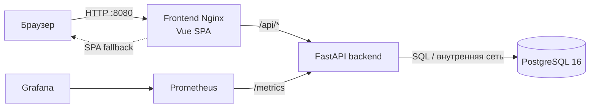

# Афиша Сургута

MVP культурной афиши: события хранятся в PostgreSQL, FastAPI предоставляет CRUD API, Vue 3 показывает афишу и позволяет искать, фильтровать, создавать, редактировать и удалять события.

Визуальная основа — предоставленный Google Stitch экспорт `stitch_afisha_cultural_events_platform/`: главная `_5`, экран поиска/каталога `_16`, детали события `_9` и дизайн-токены в `DESIGN.md`. Исходный экспорт оставлен в репозитории без изменений.

## Архитектура



Backend и PostgreSQL соединены изолированной Docker-сетью; frontend и monitoring находятся в прикладной сети. Снаружи опубликован только HTTP-порт frontend, Prometheus и Grafana доступны локально на `127.0.0.1`.

## Стек и структура

- Backend: Python 3.12, FastAPI, SQLAlchemy 2, PostgreSQL 16, Alembic, Prometheus client.
- Frontend: Vue 3 Composition API, TypeScript, Vite, Nginx unprivileged.
- Запуск: Docker Compose, Prometheus, Grafana.

```text
backend/       API, модели, миграция, демоданные для пустой базы, тесты
frontend/      SPA Vue, API-клиент, компоненты афиши и страницы события
deploy/        Prometheus и Grafana provisioning/dashboard
docs/ngrok.md  инструкция для временной публикации
compose.yaml   вся система
stitch_.../    предоставленный экспорт Google Stitch
```

## Запуск

Нужны Docker Engine/Desktop с Compose v2. Скопируйте демонстрационную конфигурацию и задайте локальные пароли:

```sh
cp .env.example .env
# замените POSTGRES_PASSWORD и GRAFANA_PASSWORD в .env
docker compose up --build -d
```

Пароль PostgreSQL подставляется в адрес подключения backend без экранирования, поэтому используйте в нём только латиницу, цифры, `-` и `_`. Пароли PostgreSQL и Grafana применяются при первом создании томов; чтобы сменить их позже, нужен `docker compose down -v` (данные будут удалены).

При запуске backend ждёт готовности PostgreSQL, до 12 раз повторяет запуск миграции Alembic и останавливается, если миграция не проходит. После миграции в пустую базу загружаются демоданные: 8 событий на ближайшие недели с началом в 19:00 по Сургуту. Если в базе уже есть события, загрузка пропускается, поэтому удалённые или изменённые события не возвращаются после перезапуска. FastAPI стартует после успешной миграции.

Frontend: <http://localhost:8080>  
API: <http://localhost:8080/api/events>  
Swagger: <http://localhost:8080/docs>  
Liveness: <http://localhost:8080/health>  
Readiness с PostgreSQL: <http://localhost:8080/ready>  
Метрики: <http://localhost:8080/metrics>  
Prometheus: <http://127.0.0.1:9090>  
Grafana: <http://127.0.0.1:3000> (учётные данные из `.env`, по умолчанию `admin`)

Vite в режиме разработки использует относительные пути и проксирует `/api`, `/health`, `/ready`, `/metrics`, `/docs` и `/openapi.json` в локально запущенный backend на `localhost:8000`. В Docker те же пути Nginx передаёт сервису `backend` через внутреннюю сеть; адрес backend определяется через DNS Docker при запросах, поэтому пересоздание контейнера backend не требует перезапуска frontend.

## API

- `GET /api/events?q=...&category=...&date_from=YYYY-MM-DD&date_to=YYYY-MM-DD` — список, поиск и фильтры.
- `GET /api/events/{id}` — событие.
- `POST /api/events` — создать.
- `PUT /api/events/{id}` — изменить.
- `DELETE /api/events/{id}` — удалить.

Форма проверяет обязательные поля браузером и отправляет типизированный JSON; backend выполняет повторную валидацию Pydantic.

Время события `starts_at` хранится в UTC и возвращается в ISO 8601 со смещением. Время без смещения (например, `2026-12-01T19:00:00`) считается местным временем Сургута (`Asia/Yekaterinburg`, UTC+5). Фильтры `date_from` и `date_to` задают календарные дни по Сургуту. Интерфейс показывает и вводит время по Сургуту независимо от часового пояса браузера.

## Мониторинг

Prometheus опрашивает `/metrics` FastAPI раз в 15 секунд. Метрики учитывают число HTTP-запросов по методу, шаблону маршрута и статусу, длительность, число запросов в обработке; `up` показывает доступность backend. Метка `path` содержит шаблон маршрута (`/api/events/{event_id}`), а адреса без маршрута собираются в `unmatched`, поэтому число временных рядов не растёт от id и случайных URL. Readiness проверяет соединение с PostgreSQL и при его недоступности отвечает `503`. В Grafana автоматически настраивается datasource Prometheus и дашборд с RPS, 4xx/5xx, p50/p95 latency и доступностью backend.

## Тесты и диагностика

Тесты API используют изолированную SQLite in-memory базу и не требуют отдельного PostgreSQL:

```sh
python3 -m venv .venv
. .venv/bin/activate
pip install -r backend/requirements.txt
cd backend && python -m pytest
```

Сборка production frontend: `cd frontend && npm ci && npm run build`.  
Состояние и healthcheck: `docker compose ps`.  
Логи: `docker compose logs -f backend frontend db`.  
Текущая версия миграций: `docker compose exec backend alembic current`.

Для сброса **всей** тестовой БД и связанных сохранённых данных используйте `docker compose down -v`, затем `docker compose up --build -d`. Команда удалит также данные Prometheus и Grafana.

## ngrok

Инструкция установки токена, запуска и остановки туннеля находится в [docs/ngrok.md](docs/ngrok.md). Туннель направляется только на опубликованный frontend-порт.

## Перенос дизайна и границы MVP

Перенесены редакционная шапка и навигация, тёплый бумажный фон, Manrope, терракотовый акцент, фильтры-чипы, подборки, карточки афиши с фотографией/категорией/датой/площадкой/ценой и мобильная сетка. Детали события следуют экрану Stitch `_9` по композиции, колонке афиши, иерархии заголовка и метаданным.

Экспорт Stitch показывает также оплату и выбор мест, личный кабинет, возвраты, отзывы, избранное и рассылку. Это за пределами CRUD MVP: неактивные элементы не обещают неподдерживаемые действия. Формы управления событиями и их подтверждение удаления добавлены как обязательный интерфейс MVP. Изображения редакционного экспорта локализованы в frontend; реальные билеты, аккаунты, избранное, оплата, подписка и авторизация отсутствуют.

## Безопасность и ограничения

- CRUD не защищён авторизацией и предназначен только для локальной демонстрации.
- Не добавляйте `.env`, пароли или ngrok token в Git. В Compose наружу не опубликованы backend и PostgreSQL.
- Для внешнего показа используйте временный туннель и отключайте его сразу после демонстрации.
- Демо пароли в `.env.example` не предназначены для production.
- В карточках есть операции редактирования и удаления, поскольку у MVP нет аккаунтов и ролей.
